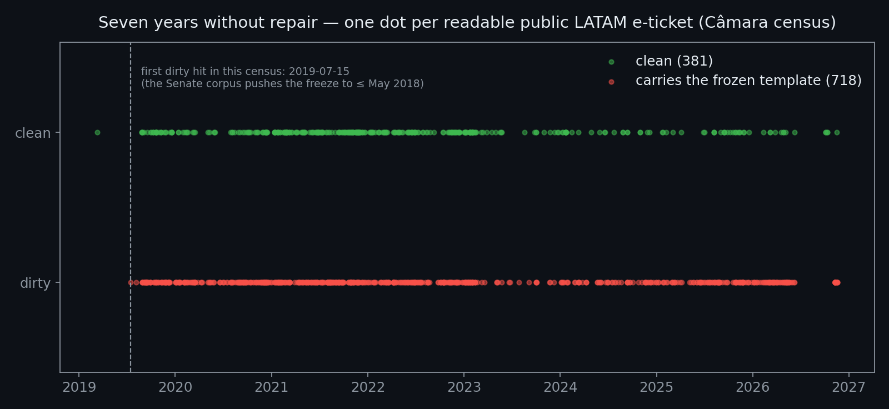
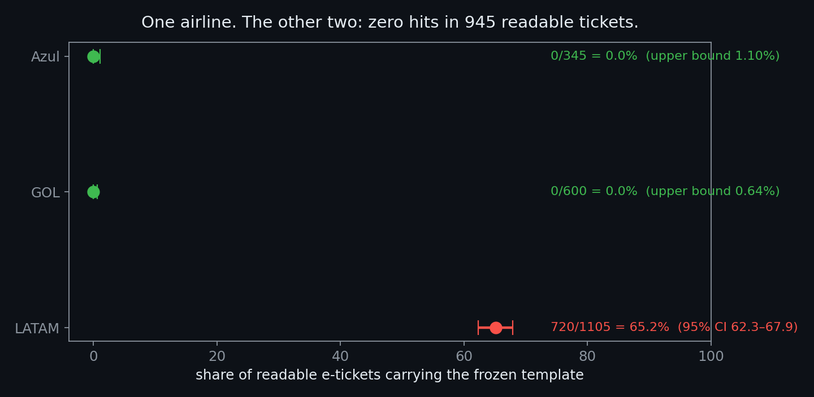
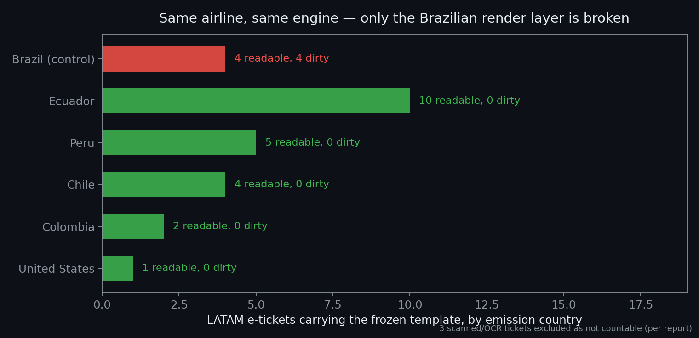
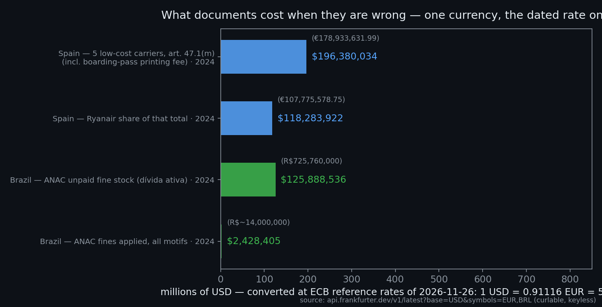

# The Bug That Boarded Eight Years

**A byte-level audit of LATAM Airlines Brasil's e-ticket template — and why every institution should care.**

*mechacut case study · 2026-11-26 · every number in this document is reproducible from the URLs in the appendix*

---

## How it started

A passenger saved a LATAM e-ticket PDF. The document looked wrong: garbled characters (`têm`, `serã`), a Spanish word where Portuguese requires its own (`Nª de orden`), fused words in the fare-rule text (`dadata`, `nãorealize`), and a city line that read **"Rio do janeiro"** — a place that does not exist. What began as one passenger's suspicion became this study: every string quoted from here on is attested in public records, dozens of times, and the originating document is not part of the evidence.

An independent agent was asked for a baseline report: is the document what it claims to be? The flight was real; the booking was real; the CNPJ printed on the ticket — LATAM's own company number, `02.012.862/0001-60` — is a valid mod-11 number. The corruption was not fraud. It was worse than fraud, because nobody was doing it. It was a machine, faithfully reproducing a broken template, over and over.

That baseline was a hypothesis. This document is the evidence.

## Method

Brazil's Federal Senate publishes its travel reimbursements — ticket PDFs included — on a public transparency portal. That portal is an unintentional time capsule of airline documents: hundreds of e-tickets, years spanned, indexed and downloadable, with passenger data already handled by public-record rules. We downloaded ticket PDFs, extracted the text layer, and searched for the specific corrupted strings. No personal document was used as evidence: **every claim below is sourced from public transparency records.**

A corrupted string is a fingerprint. If a bug is generated randomly at print time, its victims differ. If it is *frozen in a template*, the same broken bytes reappear forever, across years, passengers and orders.

## Findings

**Corpus A — LATAM, a census.** The sample became a count: the Chamber of Deputies' official bulk dumps (`camara.leg.br/cotas`, 2019–2026) were enumerated — **8,221 air-ticket reimbursement rows**, 6,350 ticket attachments fetched (6,252 real PDFs) — and 1,447 unique ids probed across the Senate ranges. Of **1,105 readable LATAM tickets, 720 carry the frozen fingerprints — 65.2% [62.3–67.9, Wilson 95%]**: `Rio do janeiro`, `E-RETIAL`, `Nª de orden`, `serã`, `responsãvel`, `dadata`, `nãorealize`, `têm`. The five core strings fire in **every census year 2019→2026**, and a spot-probe into 2018 found one text-bearing ticket (emission 2018-05-20) already dirty: **the freeze predates the window**. Inside the family, boundaries are dated: `Rio do janeiro` and `Nª de orden` join on **2021-03-29**; `têm` appears from **2026-05-17** onward — on some same-day tickets and not others (Senate docs 303857 vs 303863, both emitted 2026-11-09). The template does not decay randomly; it **branches, deterministically**, and a new branch was still being added eight years into the freeze.

**Corpus B — same passengers, other airlines.** Census control arms, same source, same readers, same period: **GOL 0/600** (95% upper bound: 0.64%) and **Azul 0/345** (upper 1.1%). And a sharper contrast: travel-agency printouts (*Reserva Aérea*, AeroTur) of **the same LATAM flights** carry none of the frozen strings — the defect is specific to LATAM's own e-ticket generator, not to Brazilian documents, not to the reimbursement pipeline, not to the flights. The bug is one pipeline.

**Corpus C — the institutions.** 237 public documents from Apple (29), xAI (13), Google (30), Microsoft (19), Banco do Brasil, Caixa, Itaú, JPMorgan and HSBC (30 prospectuses and filings, incl. a 712-page document with 47,082 correctly-encoded accented characters), plus EC/EUR-Lex antitrust decisions and SEC exhibits: **zero double-encoded sequences.**

**Corpus D — the world's other carriers.** Wave two took the identical method outside Brazil: UK/Scottish/German FOI and Bundestag records (30 documents; British Airways, Lufthansa, Air France, easyJet, Ryanair, Iberia, Wizz Air, Turkish Airlines, Emirates, Qatar, Brussels Airlines and more), US/Canadian/Australian ministerial and auditor travel files (30; Qantas, REX, Jetstar, and government itineraries), plus 15 further carriers in the Brazilian corpus (United, American, Delta, Avianca, KLM, TAP, Aerolíneas Argentinas). Across ~60 international ticket-bearing documents: **zero hits.** Where damage did appear, it was a different, separately labelled class (287 replacement characters from lossy OCR of Chinese receipts in one Scottish FOI bundle — corruption introduced by the *reader*, not the issuer). Modern document pipelines — Skia, InDesign, Word with ToUnicode maps, other airlines' own generators — produce clean text layers, even in heavily accented Portuguese.

**Corpus E — the border.** The census alone could not say whether LATAM's whole document engine is broken or only its Brazilian division, so a third wave collected LATAM e-tickets **issued outside Brazil** from public records: Ecuador 10 (SRI travel files), Peru 6, Colombia 4, Chile 4, US-issued 1 — each emission city read from the ticket text itself. **All 22 machine-readable foreign tickets are clean**: zero frozen strings, and the Spanish template carries the *correct* `Nº de orden` where the Brazilian one prints the corrupted `Nª de orden`. Same generator path (`documents-pdf`, same order-number scheme), same skeleton — four Brazil-issued controls from that very path fire the full frozen set in parallel. The defect is therefore localized: **not the group-wide document engine, but LATAM's Brazil-specific PT-BR template layer.** (Three foreign scans are excluded as scans, never counted clean.)

The contrast is the thesis: the institutions LATAM has to answer to can make verifiable documents. The airline that carries their lawmakers cannot.

## Figures

All four are generated from the ledgers themselves (`docs/corpus/`), never from this prose — the chart and the text share one formula and one data source.









## What the bytes prove — and what they don't

Proved: a deterministic pipeline is emitting, to millions of passengers, a document that mixes languages, fabricates a city, mispells its own brand (`E-RETIAL`), and fuses words inside the fare-rule text it asks the passenger to obey (`dadata`, `nãorealize`, `serã`). Dated: the core strings (E-RETIAL, dadata, nãorealize, serã, responsãvel) fire in every census year 2019→2026 and a 2018 ticket already carries them — the freeze is **at least eight years old**; the fabricated city and the Spanish-label line joined the set on 2021-03-29; a `têm`-class fare-branch first appears 2026-05-17 and is shipping today. Localization: the same generator, non-Brazil emissions clean — the corruption lives in LATAM's Brazil-specific template layer.

Not proved, and not claimed: who wrote the template. The corruption pattern is consistent with a one-time lossy conversion or a bad localization pass that froze into production — LLM involvement would be speculation, and the audit deliberately stays where the bytes reach.

## Why a typo is a contract problem

In Brazilian consumer law, ambiguity is not neutral: the Consumer Defense Code (Lei 8.078/1990, art. 6 III) guarantees *adequate and clear information*; art. 30 makes the offer binding; **art. 47 orders every contractual clause interpreted in the consumer's favor**; art. 14 imposes strict liability for service defects; ANAC Resolution 400/2016 requires information in the passenger's language. A Brazilian ticket whose own fare-rule text contains fused words (`dadata`, `nãorealize`), a Spanish form where Portuguese is owed (`Nª de orden`), a misspelled brand (`E-RETIAL`) and a non-existent city (`Rio do janeiro`) hands the passenger the favorable reading of every ambiguity it created — at scale, by default. The corruption is a frozen defect in the offer itself: a defect of the same class as a mispriced listing, except it renews itself on every emission. Nobody is sued here today; the point is that nobody can prove the clean version either. And this is not hypothetical money: Brazil's STJ has a **binding thesis** (Tema 164, 2018) that inadequate information is itself a service defect under CDC art. 14, with moral damages **not capped** by the Warsaw/Montreal tariffs; ANAC's own Resolution 400 annex prices information breaches at R$ 20,000–50,000 per conduct; and Brazilian fiscal law goes further still — an NF-e whose data area is not UTF-8 is **rejected outright** (official code 402): a mis-encoded document does not exist fiscally, blocks credit, blocks payment. The document layer is already a regulated object. Enforcement is real and recent: Senacon/Procon air-travel fines for information defects cite **R$ 4,881,796.75** across Decolar, CV Viagens, CVC, Itapemirim and 123Milhas (2021–2023); Spain's Ministry of Consumer sanctioned five low-cost airlines **€ 178,933,631.99** (2024-11-22) for, among other practices, unclear price presentation — under **article 47.1(m)** of its consumer code, the same article number, in the same century, doing the same work as Brazil's art. 47 — down to fining the **price of printing a boarding pass**. Against that backdrop, the exposure arithmetic for this one issuer (label it estimate, formula first): 34,800,000 domestic passengers/year (LATAM's own 2024 release) × 65.2% observed defect rate (text-bearing census; the scanned 57% of attachments are excluded, and whether scan-vs-text correlates with emission channel is unknown) × a plausible 1–10% reissue incidence × the published Adicional de Emissão of R$ 97 = **R$ 22M–220M per year** in customer-paid document fees alone — at 1%, more than ANAC's entire 2024 fine issuance (R$ 14M applied, ~R$ 5M collected, R$ 725.76M in unpaid fine stock per ANAC's own management report).

## The mirror

Our own bench went through the same sieve. Believing LATAM's CNPJ was a tool gap, we proposed `validate_cnpj` to our own public door. The door returned **SUSPECT-DUPLICATE** — and the replay showed it was right: the endpoint existed all along (`validate_taxid`, `kind=cnpj`). Worse, our hand-traced third gold was wrong: `52.502.963/1000-23` is not a valid CNPJ; the endpoint answered correctly, we had not. The proposal was refused and committed (`docs/proposals/validate_cnpj.json`). The real defect was discoverability — `route?q=cnpj` returned *empty* for the single word — and it was fixed the same day: `SCHEME_NAMES` now lets a bare scheme word name its tool (weights untouched; tests pinned; 2099 passed). The case study's accuser audited its own house first.

## The fix was never intelligence

No one at LATAM needs a smarter model to print a ticket. The ticket needs a pipeline that cannot lie about what it printed: generate once, hash, re-hash on every re-emission, diff the static strings, and fail **named** — not silently — when the bytes drift. Every check in this audit — encoding detection, currencyless-number refusal, date normalization, company-ID checksums, the eight-year frozen-string comparison that dated the bug — is one deterministic call, priced per use, with the same input producing the same bytes and the same sha256. A template defect frozen since before 2018 would have been caught at the first hash, by the first agent who asked.

*Same request, same bytes.* That is not a slogan; it is the only standard a document can be held to when eight years of tickets disagree with reality in exactly the same way.

---

## Control methodology — how we make sure we are not fooling ourselves

A corpus study fails in four ways: the detector sleeps, the text layer is empty, the documents are the wrong ones, or the analysts are in love with their own thesis. Each control below exists for one of those failures, and several caught something during this study.

1. **Positive control before any document.** The mojibake regex family was fired against synthetic double-encoded strings (`é` re-encoded as `é`) *before* any real file was judged. A detector that cannot fail on a known fault cannot pass on an unknown one. All three institutional agents ran this control as their first action.
2. **Two independent layers per file.** Each extracted text layer went through (a) the bench's own `file_encoding` endpoint — BOM table, strict-UTF-8 validation, named verdict, sha256 on every response — and (b) the pattern layer (the regex family). These layers *must disagree* on real mojibake: double-encoded text is valid UTF-8 of the wrong glyphs. `file_encoding` verifies the extraction; the pattern layer decides the hit. Contradictions between them are investigated, not averaged.
3. **Extraction is not innocence.** A PDF with no text layer (scan) is recorded as `scanned`, never as `clean` — 35 of 69 first-wave candidates, and **1,475 of 2,580 census attachments**, were set aside this way; rates in this study are therefore rates over the *text-bearing* population, and the scan bias is declared. Every retained file had its extracted-character density recorded; "clean" claims in this study carry a second, third or fourth *five-figure* count of correctly-decoded accented characters proving the accents were extractable in the first place (the 712-page BB prospectus: 47,082).
4. **Byte-pair probes and the substring trap.** The institutional agents examined raw `C3`/`C2` byte sequences directly, because in Portuguese documents uppercase accents (`CONTRATAÇÃO`, `MANHÃ`) legitimately produce those pairs; only lowercase double-encoding patterns counted as damage. The trap that sprang: `serã` — one of LATAM's frozen strings — is a strict **substring of the correct word `serão`**. A first-pass matcher counted clean Portuguese as evidence; the corrected needle (case-sensitive, negative context) was applied to every document on both sides of the correction, and the false positives live in the ledger, not in the numbers. The same incident, read sharply, separates two corruption layers: `têm` is an encoding defect; `serã` is a source-level typo, correctly encoded — invisible to any encoding detector and visible only to a contextual one.
5. **Same-day pairs as a falsification test.** To distinguish a time boundary from a template variant, tickets issued the same day were diffed against each other (Senate 303857 vs 303863, both 2026-11-09): a difference that survives same-day comparison is a branch, not a repair.
6. **Independent replay.** The orchestrator re-downloaded and re-ran the detector, blind to the children's ledgers, on institutional samples (a 930-page Apple SLA, a 363-page Banco do Brasil prospectus), on the same-day branch pair, on a fresh 2025 hit (Senate 268285), on the border claim (a Peruvian ticket replayed from Wayback: clean, correct `Nº de orden`, zero frozen strings), and on the money column's anchor (Spain's ministry page curled live: 178.933M€/107.775M€/art. 47.1 all present). The census itself was **recomputed from its per-file rows**, not from its summary: LATAM 720/1,105, GOL 0/600, Azul 0/345 — matching. Earlier sample counts (37/62, then 39/79 after a dedup recount) are superseded by the census; the drift is disclosed here rather than edited out. One durability note: the Senate `/trechos/` path cited in wave 1 now 404s — Wayback and the Chamber's bulk dumps are the persistent sources going forward. Child reports are treated as claims, not facts.
7. **Personal-data screen, enforced with teeth.** Three Senate reimbursement PDFs containing a client name, a CPF and account numbers were downloaded, detected, **discarded**, and logged in the ledger under `discarded` — the screen's failures are recorded alongside its passes. No passenger, deputy or account-holder appears anywhere in this study; the originating personal ticket is not part of the evidence set at all. The wave-two ledgers were checked for this programmatically: no names in, no names out.
8. **Constraint discipline.** Issuer (institution-side documents only), date (2020–2026, older kept only when noted), and hosting-vs-drafting roles (9 of 30 bank files are bank-*hosted* deal documents, marked per file) were constraints set before collection and recorded per file after.
9. **Self-audit through our own door.** The most uncomfortable controls were run on ourselves: our `validate_cnpj` proposal was refused by the public door as a duplicate (replay proved it right); a hand-traced gold in that very proposal was wrong and the endpoint's answer was right (documented verbatim in `docs/proposals/validate_cnpj.json`); and the "no CNPJ tool" claim turned out to be a probe artifact — the tool existed, unreachable by a bare word through `/route`. The real gap was fixed the same day, test-pinned, with the collision checks (`ça`/`cas`) run before the patch.
10. **Every number here is a curl away.** Document ids, URLs, per-file sha256 and the JSON ledgers are published with this study (appendix). A reader with the same bytes must reach the same verdict — otherwise it is not evidence, it is an anecdote.

## Appendix — how to curl this yourself

```bash
# one frozen fingerprint, straight from a public record (Senate, doc 303863)
curl -sL "https://www6g.senado.leg.br/transparencia/sen/download/ceaps/documento/303863" -o t.pdf
pdftotext t.pdf - | grep -o "Rio do janeiro\|E-RETIAL\|Nª de orden"

# the endpoint that already validates the airline's CNPJ
curl -s -X POST https://mechacut.studio/api/v1/validate/taxid \
  -H "Content-Type: application/json" \
  -d '{"value":"02.012.862/0001-60","kind":"cnpj"}'
# → valid=true · algorithm: mod-11 double DV (Receita Federal) · sha256

# our own refusal, on the record
# github.com/mechacut/mechacut · docs/proposals/validate_cnpj.json
```

*Sources: 720 ticket PDFs with frozen fingerprints among 1,105 readable — Senate `www6g.senado.leg.br/transparencia/sen/download/ceaps/documento/<id>` (wave-1 ids incl. 303857–303876, 303976, 303994, 303996; wave-2 July–August 2025 batch 268283–268290) and Chamber attachments via `dadosabertos.camara.leg.br` (CEAP reimbursements, per-file ids in the ledgers). Full ledgers, every file with URL + sha256 + per-string counts: `docs/corpus/` in this repository (`apple-xai.json`, `google-microsoft.json`, `banks.json`, `wave2-europe.json`, `wave2-anzus.json`, `wave2-brasil.json`, `wave3-latam-foreign.json`, `wave3-money.json`, `wave3-census.json`, plus the two wave-1 fingerprint passes; the archive README states the exclusion rules). All personal data excluded by rule: only institution-side and public-record documents were retained; three identified-person files were discarded and logged; identifiers inside the ledgers (31 CPF numbers, from CVM disclosures and discarded faturas) were masked before the archive was created.*
